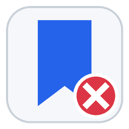

# Bookmark Cleaner

A simple app that finds and deletes dead links in your browser bookmarks.
Works on **Windows, Mac and Linux** with Chrome, Edge, Brave, Vivaldi, Opera, Firefox,
and exported bookmark `.html` files.

## Download

Go to the **[Releases](../../releases/latest)** page and download the file for your computer:

| Computer | File |
|---|---|
| Windows | `Bookmark-Cleaner-Windows.zip` |
| Mac (M1 or newer) | `Bookmark-Cleaner-Mac.zip` |
| Linux | `Bookmark-Cleaner-Linux.tar.gz` |

Unzip it and open **Bookmark Cleaner**. `READ ME FIRST.txt` inside explains everything.

## How it decides a link is dead

- **Dead** (ticked for deletion): page not found (404), page removed (410), the website no
  longer exists, or the site refuses connections.
- **Unsure** (kept): the site blocked the check, was too slow, or had a temporary error.
  These usually work fine in a real browser, so you decide.

A backup of your bookmarks is always made before anything is deleted, and it won't delete
while your browser is open.

## For developers

Pure Python 3.8+ standard library (tkinter). Run `bookmark_cleaner_gui.pyw` directly, or on
Windows double-click `Build Bookmark Cleaner.bat` to build a local `.exe`.
Every push to `main` builds all three versions with GitHub Actions; pushing a `v*` tag
publishes them as a release.
